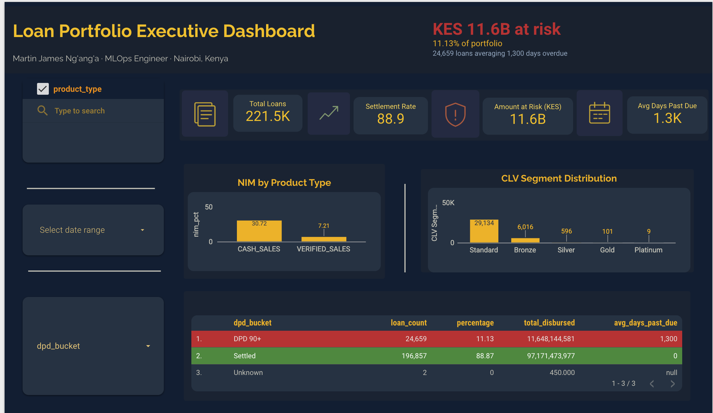

&nbsp;&nbsp;&nbsp;&nbsp;&nbsp;&nbsp;

### Building production ML for Africa's most urgent problems — fraud, climate, and language.

<table>
<tr>
<td width="55%" valign="top">

I am an ML Engineer based in Nairobi, Kenya with 10+ years of analytics experience — including 7 years delivering data science and advanced analytics to C-suite, and 4 years building production ML systems in Python: XGBoost, LightGBM, dbt, Airflow, Kafka, FastAPI — 12 systems shipped on AWS and GCP.

I don't just build models — I build the layer around them: fraud scores shaped for case management systems, credit risk outputs shaped for capital and pricing calculations, portfolio metrics shaped for provisioning and regulatory reporting. These are portfolio systems built on public data, not connected to a live bank. A model that can't be explained to a regulator, or doesn't plug into the system that has to act on it, isn't finished — it's a notebook wearing a production costume.

My work spans fraud detection (284K transactions), credit risk scoring, loan portfolio analytics (221K loans · 955K payments), deforestation monitoring, air quality forecasting, and African language AI — each one built with the same discipline: right metric, leakage-free evaluation, real monitoring, and an honest answer to "what happens to this score after it's produced."

Phase 1 shipped: 12 production systems. Phase 2 onward (below): Terraform and Kubernetes, LLM and agent engineering, epidemiological modelling, and a Kiswahili RAG + agent capstone.

Tunajijengea sisi wenyewe. 🇰🇪

</td>
<td width="45%" align="center" valign="top">

</td>
</tr>
</table>

---

<table>
<tr>
<td width="50%" valign="top">

📍 **Nairobi, Kenya** &nbsp;|&nbsp; ✉️ [ngangam93@gmail.com](mailto:ngangam93@gmail.com)

🔭 **Now:** Phase 2 — hardening churn, fraud and credit risk (leakage-free CV, out-of-fold thresholds, calibration)
🌱 **Next:** Terraform + ECS, then Kubernetes

</td>
<td width="50%" valign="top" align="center">

*"Data is only as powerful as the institution's willingness to act on it."*

</td>
</tr>
</table>

## 🔥 Proven Results

| Achievement | Detail |
|-------------|--------|
| 🌍 **Deforestation Risk Classifier** | GFW satellite API · Random Forest · SageMaker Training Jobs · S3 Parquet · East Africa · scipy KS + PSI drift monitoring · live API |
| 🌍 **Environmental anomaly detection** | ARIMA RMSE 9.93 · PM2.5 spike 469 µg/m³ detected · 11,998 OpenAQ readings · live dashboard + API |
| 🎬 **Movie Recommendation System** | Item-CF RMSE 0.9540 · P@10 69.7% · 943 users · 1,682 movies · CineAI Netflix-standard dashboard · live |
| 🎯 **Real-time fraud detection** | 284,807 transactions · Random Forest · Kafka streaming · 22ms API response · live production API |
| 💳 **Credit risk scoring + SHAP explainability** | XGBoost · SHAP waterfall per decision · audit-trail-friendly · live production API · ROC-AUC (0.703) being re-measured with leakage-free CV |
| 📊 **Loan Portfolio at Scale** | 221,518 loans · BigQuery + dbt + Airbyte · 5-task Airflow DAG, fully automated · Looker Studio dashboard · live |
| 📊 **Institutional M&E Architecture** | 50+ KPIs · Results-Based Management · World Bank KYEOP — A-rating from Ministry of Public Service |
| 🏆 **Best Paper Award** | 22nd International ICIT · Beijing Institute of Technology · 2018 · 34 countries |
---

## 🗓️ 30-Week MLOps Programme

*Phase 1: 12 production systems, built, deployed, monitored and documented on AWS EC2 Frankfurt. Phases 2–7: what comes next. Real data. Real APIs.*

 **Phase 1 complete — 12 systems shipped · Phase 2 in progress**

| Week | Project | Stack | Status |
|------|---------|-------|--------|
| **01** | Churn Prediction Pipeline | XGBoost · FastAPI · Docker · PostgreSQL · Grafana | ✅ [Live API](https://martin-mlops.com/churn/docs) · [Repo](https://github.com/M20Jay/churn-prediction-pipeline) · 🔧 rigour re-run |
| **02** | Real-Time Fraud Detection | Random Forest · Kafka · Redis · FastAPI · Docker · Grafana | ✅ [Live API](https://martin-mlops.com/fraud/docs) · [Repo](https://github.com/M20Jay/fraud-detection-pipeline) · 🔧 rigour re-run |
| **03** | Customer Segmentation | KMeans · PCA · MLflow · Evidently · Streamlit · FastAPI · Docker | ✅ [Live API](https://martin-mlops.com/segmentation/docs) · [Repo](https://github.com/M20Jay/customer-segmentation) |
| **04** | RAG Document Search System *(evolving toward LangChain · FAISS · pgvector · RAGAS · Langfuse)* | LaBSE · ChromaDB · FastAPI · pypdf · Docker | ✅ [Repo](https://github.com/M20Jay/rag-unep-documents) |
| **05** | Credit Risk Scoring + Propensity + RFM | XGBoost · SHAP · ADASYN · DVC · RFM · FastAPI · PostgreSQL · Grafana · Docker | ✅ [Live API](https://martin-mlops.com/credit/docs) · [Repo](https://github.com/M20Jay/credit-risk-scoring-pipeline) · 🔧 rigour re-run |
| **06** | Environmental Anomaly Detection + Time Series 🌍 | ARIMA · Prophet · LSTM (PyTorch) · Isolation Forest · Streamlit · FastAPI · Docker | ✅ [Dashboard](https://dashboard.martin-mlops.com) · [API](https://martin-mlops.com/airquality/docs) · [Repo](https://github.com/M20Jay/air-quality-anomaly-detection) |
| **07** | Recommendation System | Item-CF · SVD · scikit-surprise · FastAPI · Streamlit · PostgreSQL · Docker | ✅ [Dashboard](https://recommendation.martin-mlops.com) · [API](https://martin-mlops.com/recommend/docs) · [Repo](https://github.com/M20Jay/recommendation-system) |
| **08** | MLOps Automation | MLflow · DVC · Evidently AI · GitHub Actions · Prefect | ✅ Complete |
| **09** | Apache Airflow — Pipeline Orchestration | Airflow · DAGs · Scheduling · Docker · LocalExecutor | ✅ [Repo](https://github.com/M20Jay/airflow-mlops-pipeline) |
| **10** | AWS Deep Dive — Permanent Infrastructure | Elastic IP · Route 53 · Nginx · HTTPS · S3 · RDS | ✅ [Repo](https://github.com/M20Jay/airflow-mlops-pipeline) |
| **11** | Environmental Capstone 🌍 | GFW API · Random Forest · SageMaker Training Jobs · S3 Parquet · scipy drift · FastAPI · Docker | ✅ [Live API](https://martin-mlops.com/deforestation/docs) · [Repo](https://github.com/M20Jay/week11-forest-capstone) |
| **12** | Loan Portfolio at Scale — Modern Data Stack | PySpark · BigQuery · BigQuery ML · Airbyte · dbt · CLV · Looker Studio | ✅ [Repo](https://github.com/M20Jay/loan-portfolio-analysis) |

**Parked prototype:** Account Takeover / Behavioral Anomaly Detection → [account-takeover-detection](https://github.com/M20Jay/account-takeover-detection) · resumes after Phase 2.

### 🔧 Phase 2 — In progress

| Step | Project | Stack | Status |
|------|---------|-------|--------|
| **2.1** | Evaluation rigour pass: churn, fraud, credit risk | StratifiedKFold · imblearn Pipeline · OOF thresholds · isotonic calibration · PR-AUC | 🔧 In progress |
| **2.2** | Terraform + ECS reference architecture; Great Expectations on loan pipeline | Terraform · ECR · ECS Fargate · IAM · Secrets Manager · Great Expectations | ⏳ Planned |
| **2.3** | Kubernetes + Helm | Kubernetes · Helm · probes · autoscaling | ⏳ Planned |
| **2.4** | CI/CD with rollback; observability | GitHub Actions · Prometheus · Grafana · Evidently alerts | ⏳ Planned |

<b>▶ Phases 3–7: what comes next (click to expand)</b>

| Step | Project | Stack | Status |
|------|---------|-------|--------|
| **Phase 3** | **LLM and agents** | | |
| **3.1** | RAG v2 | pgvector · hybrid retrieval · RAGAS · Langfuse · FastAPI | ⏳ Planned |
| **3.2** | LLM serving + guardrails | vLLM · evaluation harness · regression tests | ⏳ Planned |
| **3.3** | Fine-tuning | LoRA · QLoRA · PEFT · model card | ⏳ Planned |
| **3.4** | Agents + MCP | LangGraph · MCP · tool use · memory | ⏳ Planned |
| **3.5** | Second-cloud LLM service | Azure OpenAI / Bedrock | ⏳ Planned |
| **Phase 4** | **Applied science** | | |
| **4.1** | SIR / SEIR epidemiology 🌍 | SciPy ODEs · R0 · scenarios · Prophet/ARIMA comparison · Bayesian parameter fitting (PyMC) · MLflow · Streamlit | ⏳ Planned |
| **4.2** | Intelligent Supply Chain | Demand forecasting · supplier risk · anomaly detection · procurement optimiser | ⏳ Planned |
| **4.3** | Experimentation | A/B test simulation · Bayesian A/B testing (Beta-Binomial, expected loss) · confounders · observational vs randomised | ⏳ Planned |
| **Phase 5** | **Data engineering depth** | | |
| **5.1–5.5** | Warehouse modelling, Spark tuning, streaming + data contracts, governance, API design | star schema · PySpark · Kafka · lineage · versioned APIs | ⏳ Planned |
| **Phase 6** | **Security and reliability** | | |
| **6.1–6.6** | Security + IAM, model governance, inference optimisation, reliability + SLOs, time-series backtesting | least privilege · model cards · quantisation · load testing · rolling-origin backtests | ⏳ Planned |
| **Phase 7** | **Capstone** | | |
| **7.1–7.3** | Kiswahili RAG + agent system on Kubernetes 🌍 | AfriBERTa · LaBSE · pgvector · LangGraph · Kubernetes · monitoring · evaluation | ⏳ Planned |
| **7.4–7.6** | Portfolio hardening, system design drills, final review | READMEs · diagrams · 10 worked system designs | ⏳ Planned |

*Every system: runs from a clean clone · leakage-free evaluation · monitoring or tests · plain-language README.*

&nbsp;
---

## 💼 Portfolio Projects

### 📊 Project 12 — Loan Portfolio at Scale *(Week 12)*

**PySpark · BigQuery · dbt · Airbyte · Airflow · Looker Studio**

Production loan portfolio pipeline processing 221,518 loans with full weekly automation — Airbyte syncs data, dbt transforms it, a CLV model retrains, an A/B test recalculates, all orchestrated through a single Airflow DAG.

- Data: 221,518 loans, 955,815 payments, ingested via Airbyte

- Metrics: PAR, DPD, NIM, CLV segmentation via BigQuery + dbt
- Orchestration: 5-task Airflow DAG, weekly, fully automated
- Dashboard: Looker Studio executive dashboard, live

*Produces PAR, DPD and NIM metrics in the shape provisioning and regulatory reporting need — designed to feed those processes, not just a dashboard.*

  

✅ Complete · Week 12 · [Repository](https://github.com/M20Jay/loan-portfolio-analysis)

---

### 🌍 Project 11 — Deforestation Risk Classifier *(Week 11)*
**GFW API · Random Forest · SageMaker Training Jobs · S3 Parquet · scipy drift · FastAPI · Docker · AWS**

Production deforestation risk classifier for East Africa using real satellite data from the Global Forest Watch API. Ingested programmatically via authenticated POST requests — no manual downloads. SageMaker Training Jobs submitted via boto3, comparing managed cloud training against self-managed EC2 training.

- Countries covered: Kenya · Tanzania · Uganda · Ethiopia · DRC
- Drift monitoring: scipy KS test + PSI (Population Stability Index)
- Pipeline: GFW API → S3 Parquet → SageMaker Training Job → FastAPI → Grafana monitoring
- 74.9ms API response time · live on AWS EC2 Frankfurt

> ✅ Complete · Week 11 · [Repository](https://github.com/M20Jay/week11-forest-capstone)

---
### ⚙️ Project 9 — Apache Airflow ML Pipeline Orchestration *(Week 9)*
**Apache Airflow · DAGs · LocalExecutor · Docker · AWS EC2 · Gmail SMTP**

Production ML pipeline orchestration layer automating the air quality system built in Week 6. Two DAGs run every Monday at 5am — a sequential retraining pipeline and a parallel training pipeline where LSTM and ARIMA train simultaneously.

**The problem solved:** A model trained once and never monitored is not a production system — it is a time bomb. Airflow ensures automatic weekly retraining on fresh OpenAQ data, catching seasonal drift before it degrades forecast accuracy.

- Sequential DAG: `pull_data → retrain_model → evaluate_model`
- Parallel DAG: `pull_data → [train_lstm + train_arima] → evaluate → notify`
- Email alert fires within seconds of any task failure
- Systemd service auto-restarts on server reboot
- Upgraded from t3.small to t3.medium after real production OOM crash at 2am

> ✅ Complete · Week 9 · 2 Production DAGs · Email Alerting Live · [Repository](https://github.com/M20Jay/airflow-mlops-pipeline)

---

### 🌍 Project 6 — Environmental Anomaly Detection + Time Series *(Week 6)*
**ARIMA · Prophet · LSTM (PyTorch) · Isolation Forest · Streamlit · FastAPI · Docker · AWS EC2**

Production environmental monitoring pipeline trained on 11,998 real PM2.5 sensor readings from 5 Nairobi locations via OpenAQ. Answers two questions automatically for every hourly reading: What will PM2.5 be next? Is this reading dangerous?

**Key EDA findings:**
- PM2.5 peaks at **4am every day** — night burning trapped in cold air
- **Friday** is consistently the worst day of the week
- Maximum spike: **469 µg/m³** on 2024-02-18 at 4am — **93x the WHO annual safe limit**
- 1.8% of all readings exceed the dangerous US EPA threshold of 55 µg/m³

| Model | RMSE | MAE | Type |
|---|---|---|---|
| **ARIMA ✅ Best** | **9.93** | **8.35** | Forecasting |
| LSTM (PyTorch) | 19.46 | 17.87 | Deep Learning |
| Prophet | 22.05 | 19.40 | Forecasting |
| Isolation Forest | — | — | Anomaly Detection |

> ✅ Complete · Week 6 · Tests: 10/10 passing · [Repository](https://github.com/M20Jay/air-quality-anomaly-detection)

---

### 💳 Project 5 — Credit Risk Scoring Pipeline *(Week 5)*
**XGBoost · SHAP · ADASYN · DVC · RFM · FastAPI · PostgreSQL · Grafana · Docker · AWS EC2**
Credit risk scoring for loan applicants — answers three questions simultaneously: Will they default? Will they accept the offer? How valuable are they? Built on 252,971 real LendingClub loans. ROC-AUC 0.703 (being re-measured with leakage-free cross-validation and calibration). SHAP explanation stored for every decision — an audit-trail-friendly design. Propensity scoring, RFM segmentation, 6-panel Grafana monitoring dashboard, PostgreSQL predictions storage.

*Outputs a default probability designed to feed capital and pricing calculations, not just a scoring endpoint.*

> ✅ Complete · Week 5 · [Repository](https://github.com/M20Jay/credit-risk-scoring-pipeline)

---

## 🛠️ Skills

**💻 Programming and Data Science**
&nbsp;
&nbsp;
&nbsp;
&nbsp;
&nbsp;
&nbsp;

**🤖 NLP and AI**
&nbsp;
&nbsp;
&nbsp;
&nbsp;
&nbsp;
&nbsp;

**⚙️ Deployment and Infrastructure**
&nbsp;
&nbsp;
&nbsp;
&nbsp;
&nbsp;

**☁️ Cloud and MLOps**
&nbsp;
&nbsp;
&nbsp;
&nbsp;
&nbsp;
&nbsp;

**📊 Visualisation and BI**
&nbsp;
&nbsp;
&nbsp;
&nbsp;

---

## 🎯 Core Competencies

| Area | Skills |
|------|--------|
| **Fintech ML** | Credit risk · fraud detection · CLV · RFM · propensity models · PAR · NIM · DPD · cohort analysis · 5 fintech domains |
| **Machine Learning** | Fraud detection · churn · credit risk · segmentation · time series forecasting · anomaly detection · SHAP explainability · leakage-free cross-validation · calibration · threshold selection |
| **Deep Learning** | LSTM (PyTorch) · sequence modelling · time series · OOP neural network architecture |
| **MLOps** | End-to-end pipelines · Docker · MLflow · Evidently drift monitoring · pytest · DVC |
| **Streaming** | Real-time scoring · Apache Kafka · Redis caching · sub-22ms latency |
| **NLP & RAG** | Semantic search · LaBSE · ChromaDB · vector embeddings · multilingual · 109 languages |
| **Environmental ML** | Air quality forecasting · PM2.5 anomaly detection · OpenAQ · ARIMA · Isolation Forest |
| **Cloud AWS** | EC2 · S3 · RDS · IAM · SageMaker · Route 53 · Nginx · HTTPS |
| **Cloud GCP** | BigQuery · BigQuery ML · Cloud Run · Looker Studio |
| **Research & M&E** | MSc Marketing Analytics · World Bank KYEOP · RBM · 50+ KPI frameworks · Board diversity research |

---

## 🌐 Socials

&nbsp;
&nbsp;
&nbsp;

---

## 📈 GitHub Stats

---

## 🏆 Goals

- 🎓 **MSc Marketing Analytics** — University of Nairobi
- 🌍 **Kiswahili NLP** — Building African language AI for East African communities — capstone in Phase 7
- ☁️ **AWS + GCP Certification** — Target 2026
- 🎓 **Georgia Tech OMSCS** — MSc Computer Science, AI Specialisation — Target Aug 2027
- 🔬 **PhD Quantitative Finance / Financial Data Science** — AfDB / NUS / Edinburgh — Target 2029

---

*"A model that can't explain a decision, or doesn't plug into the system that acts on it, isn't finished."*

### Tunajijengea sisi wenyewe. 🇰🇪

